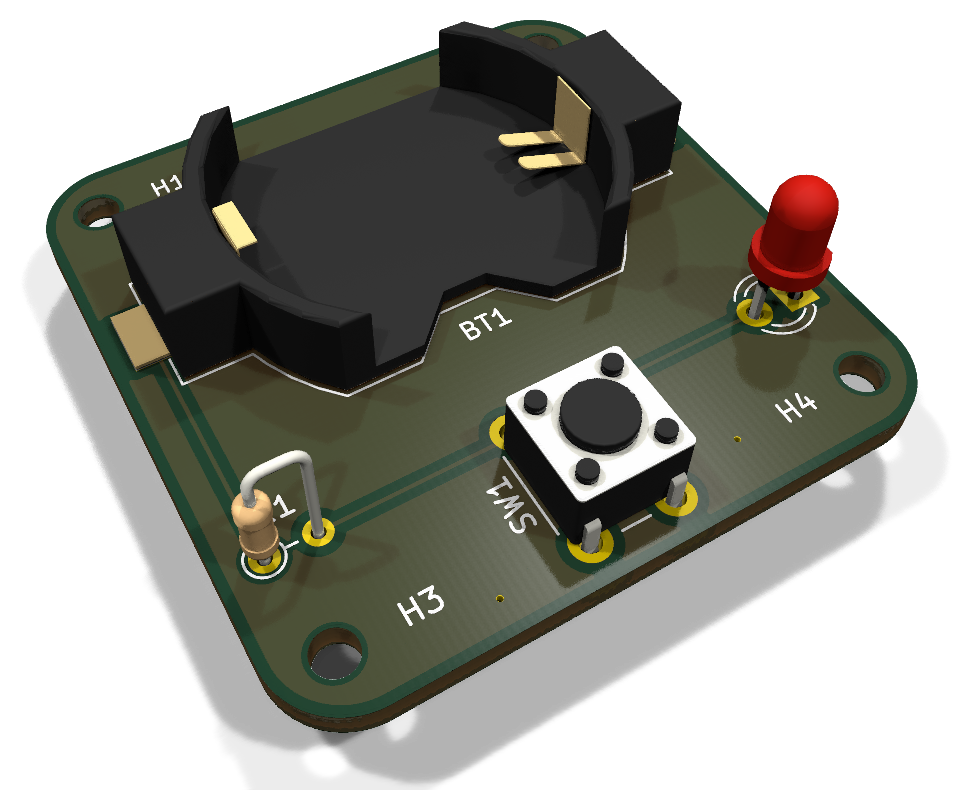
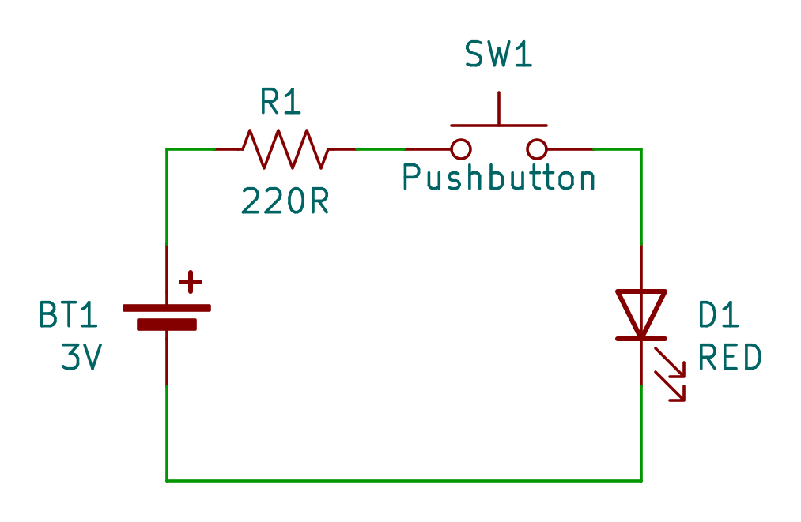
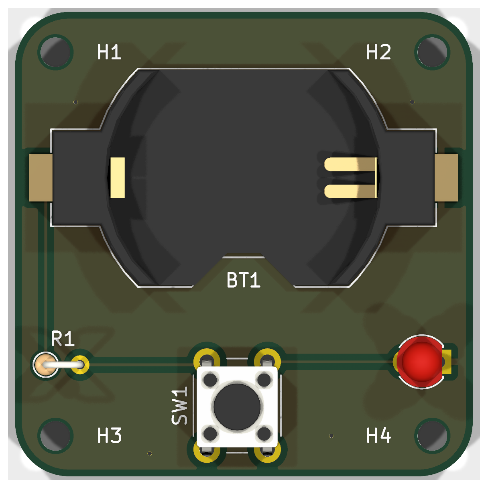

# Hello PCB

A first PCB: a CR2032 coin cell lights a red LED while you hold down a pushbutton.
Designed in KiCad 10.



## Circuit



Pressing SW1 completes the loop from the cell through R1 and D1. With a 3 V cell and a red LED
dropping about 2 V, R1 limits the current to roughly 4–5 mA.

## Board



| | |
|---|---|
| Size | 34.0 × 32.4 mm, 4 mm corner radius |
| Layers | 2: tracks on top, GND fill on both sides, joined by 4 stitching vias |
| Mounting | 4 × M2 holes (2.2 mm, non-plated), 3 mm in from each corner (H1–H4) |
| Parts | All through-hole except the battery holder (surface mount) |

## Parts

| Ref | Part | Manufacturer | MPN | DigiKey | Mouser |
|---|---|---|---|---|---|
| BT1 | CR2032 holder | Keystone Electronics | 1058 | 36-1058-ND | 534-1058 |
| BT2 | CR2032 cell (not on board) | Panasonic | CR2032 | 11-CR2032-ND | 614-CR2032-200 ¹ |
| D1 | Red LED, 3 mm | Kingbright | WP710A10ID | 754-1606-ND | 604-WP710A10ID |
| R1 | 220 Ω, ¼ W, 1% | YAGEO | MFR-12FTF52-220R | 13-MFR-12FTF52-220RCT-ND | 603-MFR-12FTF52-220R |
| SW1 | 6 mm tactile switch, normally open | Aratas (formerly Omron) | B3F-1000 | SW400-ND | 653-B3F-1000 |

¹ The Mouser part is a Renata CR2032. Any CR2032 fits.

The parts for one board came to about $2.40 at either distributor in November 2026.

### Costed BOM

`tools/costed_bom.py` exports the BOM from the schematic and prices it with live DigiKey and
Mouser data:

```sh
python3 tools/costed_bom.py --boards 1,10
```

It writes `build/hello-pcb-bom.csv` and `build/hello-pcb-bom-costed.csv`. It needs API
credentials in `~/.config/distributor-api.env`:

```
MOUSER_API_KEY=...
DIGIKEY_CLIENT_ID=...
DIGIKEY_CLIENT_SECRET=...
```

The DigiKey credentials need a Production app subscribed to Product Information v4.

## Ordering boards

Upload `hello-pcb.kicad_pcb` directly to [OSH Park](https://oshpark.com/). No Gerber files are
needed, and a KiCad 10 file works. OSH Park doesn't refill the copper zones, so after editing
the board, press **B** in the PCB editor before saving.

## Files

| File | Contents |
|---|---|
| `hello-pcb.kicad_pro` | KiCad project |
| `hello-pcb.kicad_sch` | Schematic, with distributor part numbers on each symbol |
| `hello-pcb.kicad_pcb` | Board layout |
| `tools/costed_bom.py` | BOM export and live pricing script |
| `docs/` | Board renders for this README |
| `LICENSE` | CERN-OHL-P-2.0 licence text |

## License

This design is licensed under the
[CERN Open Hardware Licence Version 2 – Permissive](https://ohwr.org/cern_ohl_p_v2.txt)
(SPDX: `CERN-OHL-P-2.0`). You may use, modify, share and make boards from it, including
commercially. The full text is in [LICENSE](LICENSE).
